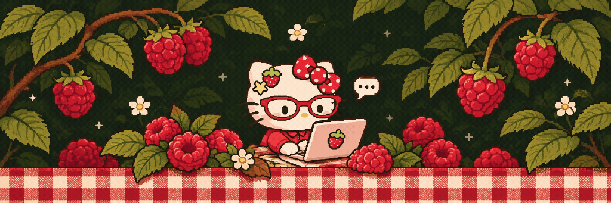
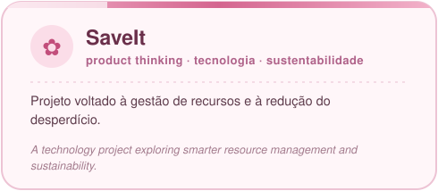

 

  

 

## Sobre mim

Oi! Sou a **Mariana Torres**, mas pode me chamar de **Mari**.

Sou apaixonada por tecnologia, design e por transformar ideias em experiências que realmente façam sentido para as pessoas. Gosto de explorar o lado criativo do Figma, dar vida às interfaces com código e descobrir histórias por trás dos dados.

Atualmente, estou construindo meu caminho na tecnologia, unindo o que aprendo na escola com os desafios do dia a dia no trabalho. Tenho um carinho especial por **UX/UI Design**, área em que quero me aprofundar cada vez mais, sem deixar de lado minha curiosidade por desenvolvimento e dados.

| | |
| --- | --- |
| **Formação** | Ensino Médio Técnico em Tecnologia na Germinare Tech |
| **Atuação** | Assistente de Desenvolvimento em Risco de Crédito no PicPay |
| **Interesses** | UX/UI Design, Front-end e Análise de Dados |
| **Atualmente** | Aprofundando meus conhecimentos em design de interfaces e experiência do usuário |
| **Além do código** | Ukulele, música, cinema e um carinho especial por *Anne with an E* |

A little about me, in English

 

Hi! I'm **Mariana Torres**, but you can call me **Mari**.

I'm a technology student at **Germinare Tech** and currently work as a **Development Assistant in Credit Risk at PicPay**.

I love combining creativity and technology to turn ideas into meaningful digital experiences. I'm especially interested in **UX/UI Design**, but I also enjoy front-end development, exploring data and learning new things along the way.

When I'm not designing or coding, you'll probably find me playing the ukulele, listening to music, watching a good movie or rewatching *Anne with an E*.

## Stack

O que estou estudando na Germinare Tech

 

| Área | O que estou aprendendo |
| --- | --- |
| Front-end | HTML, CSS, JavaScript, responsividade e interfaces web |
| Back-end | Python, Java, APIs REST, FastAPI e integração de sistemas |
| Banco de dados | SQL, PostgreSQL, modelagem, consultas e CRUD |
| UX/UI e IHC | Figma, pesquisa, wireframes, protótipos, usabilidade, acessibilidade e testes A/B |
| Inteligência artificial | LLMs, agentes de IA, LangGraph e bancos vetoriais com Qdrant |
| Dados e BI | Pandas, PySpark, tratamento de dados, dashboards e indicadores |
| Estatística | Probabilidade, distribuições e testes de hipóteses |
| Mobile | Android, Kotlin, Firebase e integração com APIs |
| DevOps | Git, GitHub, Linux, Docker, Kubernetes e deploy |
| Engenharia de software | Requisitos, documentação, testes, arquitetura e trabalho em equipe |

## Projetos

<table>
<tr>
<td align="center"></td>
<td align="center"></td>
</tr>
<tr>
<td align="center"></td>
<td align="center"></td>
</tr>
</table>

## Música

Por aqui, quase tudo tem uma trilha sonora. Gosto muito de **MPB**, que está sempre presente nos meus dias, seja enquanto estou criando alguma coisa ou só aproveitando o momento.

Atividade no GitHub

 

<picture>
  <source media="(prefers-color-scheme: dark)" srcset="https://raw.githubusercontent.com/mariitorrs/mariitorrs/output/github-contribution-grid-snake-dark.svg" />
  
</picture>

