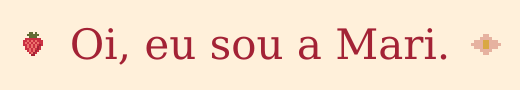
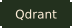
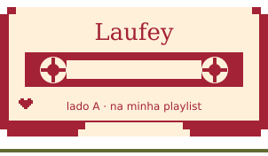
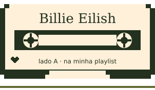

<em>interfaces, dados e um pouquinho de música.</em>

  

 

## Um pouco sobre mim

Sou a **Mariana Torres**, mas pode me chamar de **Mari**. Estudo tecnologia na **Germinare Tech** e trabalho como **Assistente de Desenvolvimento em Risco de Crédito no PicPay**.

Gosto de criar interfaces, pensar em como deixar uma experiência mais simples e entender o que os dados têm para contar. Entre o Figma e o código, vou aprendendo e colocando minhas ideias em prática.

- **No trabalho:** análise de dados, dashboards e risco de crédito.
- **Nos projetos:** UX/UI, front-end e soluções com inteligência artificial.
- **Fora da tela:** ukulele, música, filmes e um carinho especial por *Anne with an E*.

A little about me, in English

 

Hi! I'm **Mariana Torres**, but you can call me **Mari**. I study technology at **Germinare Tech** and work as a **Development Assistant in Credit Risk at PicPay**.

I enjoy designing interfaces, making experiences easier to use and exploring what data can tell us. My projects bring together UX/UI, front-end development and AI. Outside of coding, I like playing the ukulele, listening to music and watching films.

 

## O que uso e estudo

**Desenvolvimento**

       

**Dados e inteligência artificial**

     

Tratamento e visualização de dados, Business Intelligence, estatística aplicada, LLMs e agentes de IA.

**Design e experiência**

    

Pesquisa com usuários, jornadas, testes de usabilidade, Design Systems e UI Kits.

**Ferramentas e infraestrutura**

    

Mais sobre o que estudo na Germinare Tech

 

| Área | O que estou aprendendo |
| --- | --- |
| Front-end | HTML, CSS, JavaScript, responsividade e interfaces web |
| Back-end | Python, Java, APIs REST, FastAPI e integração de sistemas |
| Banco de dados | SQL, PostgreSQL, modelagem, consultas e CRUD |
| UX/UI e IHC | Figma, pesquisa, wireframes, protótipos, usabilidade, acessibilidade, heurísticas e testes A/B |
| Inteligência artificial | LLMs, agentes de IA, LangGraph, integração com APIs e bancos vetoriais com Qdrant |
| Dados e BI | Pandas, PySpark, tratamento de dados, dashboards e análise de indicadores |
| Estatística | Probabilidade, distribuições normal e binomial e testes de hipóteses |
| Mobile | Android, Kotlin, Firebase e integração com APIs |
| DevOps | Git, GitHub, Linux, Docker, Kubernetes, containers e deploy |
| Engenharia de software | Requisitos, documentação, testes, arquitetura e desenvolvimento colaborativo |

 

## Projetos que fazem parte do caminho

<h3></h3>

Uma plataforma para organizar estoques de alimentos, acompanhar validades e ajudar a reduzir desperdícios. Minha participação é voltada ao **design das interfaces e à experiência do usuário**.

UX/UI · Figma · Design Thinking · Prototipação

<h3></h3>

Um assistente financeiro que reúne inteligência artificial, integrações e dados. Um projeto para colocar em prática o que venho aprendendo sobre **agentes de IA e desenvolvimento de APIs**.

Python · FastAPI · LangGraph · PostgreSQL · Qdrant

<h3></h3>

Um projeto sobre gestão de recursos e redução do desperdício, desenvolvido em equipe. Foi uma oportunidade de pensar em como a **tecnologia pode ajudar a aproveitar melhor o que já temos**.

Tecnologia · Sustentabilidade · Desenvolvimento em equipe

<h3></h3>

Estudos de telas, fluxos e protótipos que fazem parte do meu aprendizado em design. Gosto de cuidar dos detalhes e testar formas de deixar uma interface **mais clara e agradável de usar**.

Figma · Pesquisa com usuários · UI Kit · Acessibilidade

 

  

## Entre um código e outro

Quase sempre tem música por aqui. **Laufey** e **Billie Eilish** estão entre as minhas favoritas — e, quando dá, também gosto de tocar um pouco de ukulele.

 

<b>Minha atividade no GitHub</b>

 

<picture>
  <source media="(prefers-color-scheme: dark)" srcset="https://raw.githubusercontent.com/mariitorrs/mariitorrs/output/github-contribution-grid-snake-dark.svg" />
  
</picture>

 

## Vamos conversar?

Gosto de trocar ideias sobre design, tecnologia e dados. Você pode me encontrar no [LinkedIn](https://www.linkedin.com/in/mariana-torres-aa95453b5/) ou no [Instagram](https://www.instagram.com/marii.torrs/).

 
