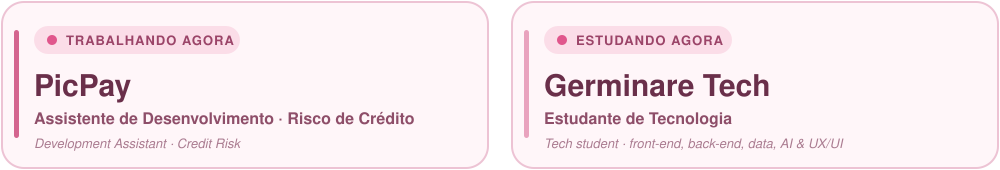

<div align="center">



<a href="https://www.linkedin.com/in/mariana-torres-aa95453b5/"></a>
<a href="https://www.instagram.com/marii.torrs/"></a>
<a href="https://open.spotify.com/user/31qn7tgllym4wdjjclx6cgggxv5u?si=cf243e39488b45db"></a>

</div>

<br />

### ୨୧ now · agora

<div align="center">

</div>

<br />

### ✿ about · sobre mim

<table><tr><td width="55%" valign="top">

**pt-br**  ·  oii! eu sou a **Mariana**, mas pode me chamar de **Mari**. hoje atuo como **assistente de desenvolvimento em Risco de Crédito no PicPay** e sou estudante de tecnologia na **Germinare Tech**. gosto de unir os dois lados: interfaces cheias de cuidado e a leitura dos dados por trás de cada ideia. ♡

**en**  ·  hi! i'm **Mariana**, but you can call me **Mari**. i work as a **development assistant in Credit Risk at PicPay** and study technology at **Germinare Tech**. i love connecting both worlds: thoughtfully designed interfaces and the stories hidden in data.

</td><td width="45%" valign="top">

```yaml
mari:
  based_in: Brazil
  work: PicPay · Risco de Crédito
  study: Germinare Tech
  loves: [UX/UI, front-end, analytics]
  exploring: [AI agents, FastAPI, data]
  offline: [ukulele, music, movies]
  vibe: soft pink + curious mind
```

</td></tr></table>

<div align="center"></div>

### ✧ stack · o que eu estudo e uso

<div align="center">

**desenvolvimento** · front-end, back-end e mobile


**dados & inteligência artificial**

<br />


**design & experiência**

<br />


**infra & colaboração**


</div>

<details>
<summary><b>✿ ver o mapa completo do que eu estudo na Germinare Tech</b></summary>

<br />

| Área | Conteúdos e tecnologias |
|---|---|
| **Desenvolvimento Front-end** | HTML5, CSS3, JavaScript, responsividade, interfaces web |
| **Desenvolvimento Back-end** | Python, Java, APIs REST, FastAPI, integração de sistemas |
| **Banco de Dados** | SQL, PostgreSQL, modelagem de dados, consultas, CRUD |
| **UX/UI Design** | Figma, prototipação, wireframes, Design Thinking, Design System, UI Kit, pesquisa com usuários |
| **Interação Humano-Computador (IHC)** | Usabilidade, acessibilidade, heurísticas, testes A/B, jornadas do usuário |
| **Inteligência Artificial** | LLMs, agentes de IA, LangGraph, integração com APIs, Qdrant e bancos vetoriais |
| **Análise de Dados** | Python, Pandas, PySpark, tratamento e visualização de dados |
| **Business Intelligence** | Dashboards, análise de indicadores, visualização de informações |
| **Estatística Aplicada** | Probabilidade, distribuição normal, distribuição binomial e testes de hipóteses |
| **DevOps e Infraestrutura** | Git, GitHub, Linux, Docker, Kubernetes, deploy e containers |
| **Desenvolvimento Mobile** | Android, Kotlin, interfaces mobile, Firebase, integração com APIs |
| **Engenharia de Software** | Levantamento de requisitos, documentação, testes, arquitetura e desenvolvimento de projetos |
| **Metodologias de Projeto** | Design Thinking, desenvolvimento colaborativo, organização de entregas e projetos interdisciplinares |

</details>

<div align="center"></div>

### ♡ projects · projetos

<table>
<tr>
<td width="50%"></td>
<td width="50%"></td>
</tr>
<tr>
<td width="50%"></td>
<td width="50%"></td>
</tr>
</table>

<div align="center"><sub>✿ mais projetos florescendo nos meus repositórios · more projects blooming in my repositories</sub></div>

<div align="center"></div>

### ☕ github diary · estatísticas

<div align="center">


<!-- A cobrinha aparece depois que o workflow snake.yml for executado e criar a branch output. -->
<picture>
  <source media="(prefers-color-scheme: dark)" srcset="https://raw.githubusercontent.com/mariitorrs/mariitorrs/output/github-contribution-grid-snake-dark.svg" />
  
</picture>

</div>

<div align="center"></div>

### ♫ soundtrack · minhas músicas

<div align="center">

<a href="https://open.spotify.com/user/31qn7tgllym4wdjjclx6cgggxv5u?si=cf243e39488b45db"></a>

<!-- OPCIONAL: widget de faixas recentes do Spotify.
Autorize em https://spotify-recently-played.jeffreyca.workers.dev/ , gere o snippet e cole aqui.
Sem autorização a imagem fica quebrada, por isso está comentado.

-->

<sub>quando não estou codando, provavelmente estou ouvindo música ou tocando ukulele ♡</sub>

<br />

`🎧 music` &nbsp; `🎬 Anne with an E` &nbsp; `🎹 Laufey` &nbsp; `🌙 Billie Eilish` &nbsp; `🎨 making things pretty` &nbsp; `🐈 cats`

</div>

<div align="center"></div>

### ✉ let's connect · vamos conversar

<div align="center">

<sub>sempre aberta a trocar ideias sobre tecnologia, design e dados · always happy to chat about tech, design & data</sub>

<br /><br />

<a href="https://www.linkedin.com/in/mariana-torres-aa95453b5/"></a>
<a href="https://www.instagram.com/marii.torrs/"></a>

<br /><br />


<sub>feito com carinho pela Mari ♡ · made with love, curiosity & many little design decisions</sub>

</div>
