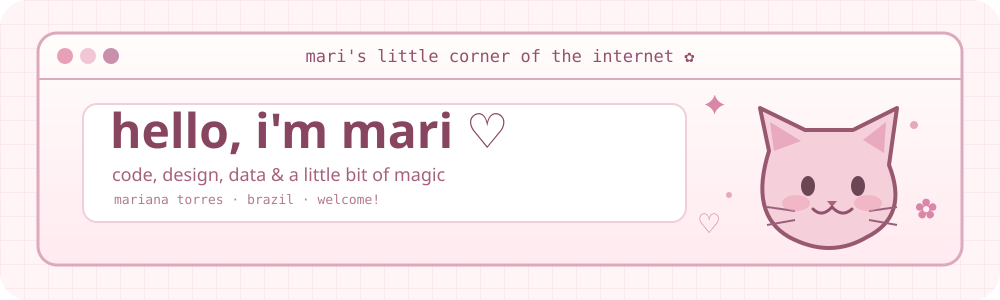

<div align="center">




<a href="https://www.linkedin.com/in/mariana-torres-aa95453b5/"></a>
<a href="https://www.instagram.com/marii.torrs/"></a>
<a href="https://open.spotify.com/user/31qn7tgllym4wdjjclx6cgggxv5u?si=cf243e39488b45db"></a>

</div>

### ୨୧ about the girl behind the screen

<table><tr><td width="55%" valign="top">

**pt-br**  ·  oii! eu sou a **Mariana**, mas pode me chamar de **Mari**. sou estudante de tecnologia na **Germinare Tech** e trabalho com **Risco de Crédito no PicPay**. adoro a parte de criar: desde uma interface cheia de detalhes até entender os dados por trás de uma ideia. ♡

**en**  ·  hi! i'm **Mariana**, but you can call me **Mari**. i'm a tech student at **Germinare Tech**, working in **Credit Risk at PicPay**. i love the creative side of technology — from thoughtfully designed interfaces to the stories hidden in data.

</td><td width="45%" valign="top">

```yaml
mari's little notes:
  based_in: Brazil
  currently: Credit Risk & Data
  loves: [UX/UI, front-end, analytics]
  learning: [AI, Python, product design]
  offline: [ukulele, music, movies]
  vibe: soft pink + curious mind
```

</td></tr></table>

<div align="center">

<sub>✦ a little curiosity, a little creativity, a lot of learning ✦</sub>

</div>

### ✿ my creative toolbox · minhas ferramentas

<div align="center">

**dev & data**


**design & product**


<sub>i like giving both the code and the pixels a little extra care ♡</sub>

</div>

### ♡ little things i've been building · meus projetos

<table>
<tr><td width="50%" valign="top">

**❄️ Frigus**  
*UX/UI · product design · front-end*

Uma solução para organizar estoques de alimentos, acompanhar validades e ajudar a reduzir desperdícios.

*A food inventory experience designed to make organization easier and reduce waste.*

</td><td width="50%" valign="top">

**✦ AI Financial Advisor**  
*Python · AI · APIs*

Projeto de um assistente financeiro com inteligência artificial, combinando lógica, integrações e dados.

*An AI-powered financial assistant combining logic, integrations and data.*

</td></tr><tr><td width="50%" valign="top">

**🌱 SaveIt**  
*product thinking · technology · sustainability*

Projeto voltado à gestão de recursos e à redução do desperdício.

*A technology project exploring smarter resource management and sustainability.*

</td><td width="50%" valign="top">

**🎨 UX experiments & interfaces**  
*Figma · UX research · prototypes*

Gosto de transformar problemas em fluxos, interfaces e experiências mais intuitivas.

*Turning research and ideas into thoughtful, usable digital experiences.*

</td></tr>
</table>

<div align="center"><sub>✿ more projects are slowly blooming on my repositories</sub></div>

### ☕ my github diary · estatísticas

<div align="center">


<!-- A cobrinha aparece depois que o workflow snake.yml for executado e criar a branch output. -->
<picture>
  <source media="(prefers-color-scheme: dark)" srcset="https://raw.githubusercontent.com/mariitorrs/mariitorrs/output/github-contribution-grid-snake.svg" />
  
</picture>

</div>

### ♫ soundtrack of my days · minhas músicas

<div align="center">

<a href="https://open.spotify.com/user/31qn7tgllym4wdjjclx6cgggxv5u?si=cf243e39488b45db">♫ visit my spotify profile</a>

<!-- IMPORTANTE: autorize seu Spotify em https://spotify-recently-played.jeffreyca.workers.dev/ .
Depois de conectar, gere o snippet pelo configurador e substitua a linha abaixo.
Seu Spotify user ID: 31qn7tgllym4wdjjclx6cgggxv5u -->


<sub>when i'm not coding, i'm probably listening to music or playing my ukulele ♡</sub>

</div>

### ✧ tiny favorites · coisas que eu amo

<div align="center">

`🎧 music` &nbsp; `🎬 Anne with an E` &nbsp; `🎹 Laufey` &nbsp; `🌙 Billie Eilish` &nbsp; `🎨 making things pretty` &nbsp; `🐈 cats`


<sub>made with love, curiosity & many little design decisions · feito com carinho pela Mari ♡</sub>

</div>
